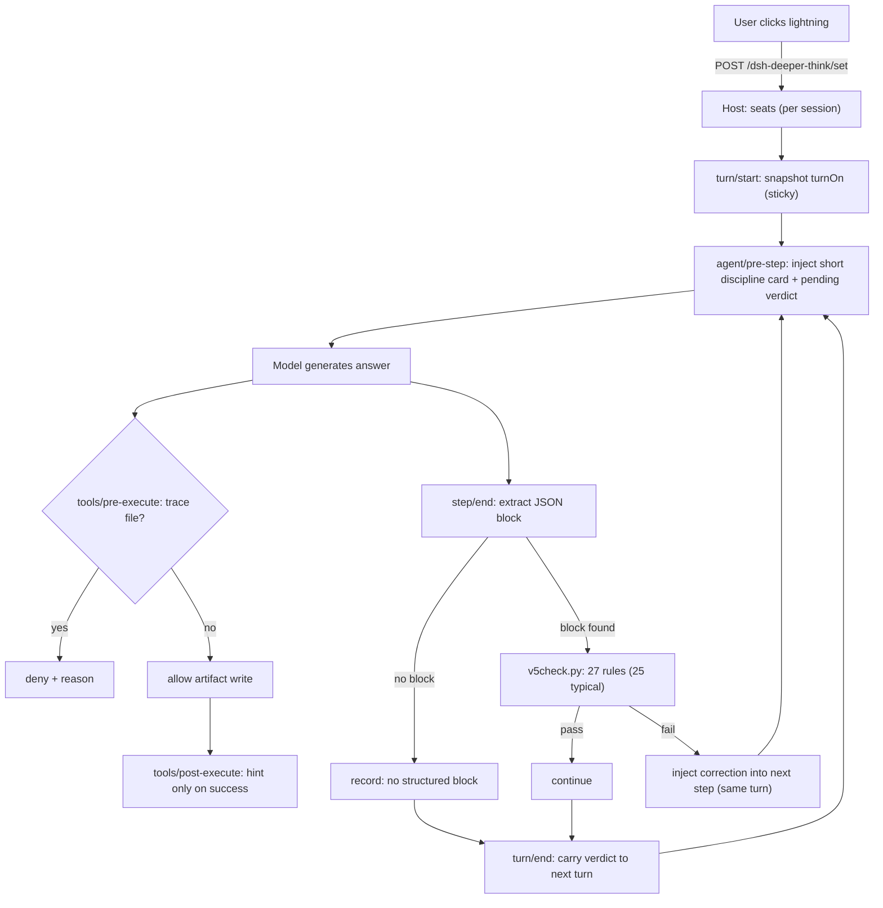

# dsh-deeper-think

**English** | [简体中文](README.zh-CN.md)

A DSH Desktop composer plugin that spends the extra tokens on **falsifiable checks for questions without an oracle** — rather than on longer answers — and verifies that the model actually performed those checks.

The plugin does not make the model smarter; it replaces the stopping criterion ("looks right") with "the checklist is settled", externalizes the evidence as a structured block, and runs a deterministic checker on every step.

- Package: `dsh-deeper-think`
- Version: `0.1.9`
- Author: 七七 (Voyager77Twt)
- License: MIT
- Compatibility: DSH Desktop 0.2.x (tested with `agent/pre-step`, `tools/pre-execute`, `tools/post-execute`, `session/event`); Python 3 (tested 3.12) for the checker; Windows for the offline installer

The checker runs outside the model. Without Python it reports "not run" instead of silently passing. The plugin does not sandbox the model; see [Limitations](#8-limitations-and-threat-model).

---

## Quick start

> **0.1.9 is an early internal build.** The protocol and rule set may still change. Test on a copy of your data and keep backups.

1. Install via **Settings → Plugins** (plugin manager / marketplace channel), or run `install.ps1` offline;
2. Turn on the lightning next to the model selector;
3. Ask a question without a verifiable oracle (for example, "check whether this UI state is consistent with the spec");
4. Watch for the injected `[dsh-deeper-think]` card and the `v5check：x/25` verdict (typical block) in the next turn.

The plugin is only active while the switch is on. When it is off, DSH behaves exactly as before.

---

## Flow map



Mind map of the same flow:

```text
dsh-deeper-think
├─ trigger
│  ├─ lightning toggle (client.js, per session)
│  └─ turn snapshot (turnOn, sticky)
├─ per step
│  ├─ pre-step: discipline card (seven steps + block schema + cost budget)
│  ├─ pre-execute: deny six trace files, allow artifacts
│  └─ post-execute: success-only write hint
├─ verification
│  ├─ step/end: extract JSON block from the answer
│  ├─ v5check.py: 27 rules (25 typical) — boundary / necessary conditions / criteria / demos / order & honesty
│  └─ fail: correction injected into the same turn
└─ settlement
   ├─ turn/end: verdict (pass, fail, or missing block)
   └─ next turn: verdict carried into the pre-step card
```

The five in-memory ledgers that make this work:

| Ledger | Holds | Why it exists |
|---|---|---|
| `seats` | on/off per session | state sent by the button |
| `turnOn` | snapshot at `turn/start` | a mid-turn off must not break the current turn |
| `lastText` | latest assistant text | source for block extraction |
| `pending` | message for the next step/turn | hooks cannot rewrite the message just produced |
| `checked` | fingerprint of checked text | avoid re-running the checker on the same text |

Restart clears all in-memory state: the switch defaults to off and DSH behaves as before.

---

## 1. Why: verification without an oracle

When there is no oracle, "verify" cannot mean "compare with the correct answer". It can only mean **falsification**: find a necessary condition that any correct result must satisfy, and check whether it is violated. A violation proves an error; satisfying the condition does not prove correctness (a one-sided test) [1].

Three families of necessary conditions have established engineering practice:

| Family | Necessary condition | Established method |
|---|---|---|
| Inventory | Everything required is present; nothing extra | Inspection checklists [8] |
| Metamorphic | A semantics-preserving transformation preserves a relation | Metamorphic testing [2], [3] |
| Consistency | Two representations of the same information agree | Differential testing [6]; N-version [7] |

The plugin also refuses to trust the model's self-report: self-correction without external feedback is unreliable [9], and iterative self-critique is weak even when the critique content is correct [10]. The checker therefore runs **outside** the model, in the host.

---

## 2. What it does

- **Per-conversation toggle** next to the model selector (hollow = off, filled = on). Default off; state resets on restart.
- **Sticky per turn**: the switch is snapshotted at `turn/start`; turning it off mid-turn does not break the current turn.
- **Per-step discipline card**: a short injected message (~300–500 tokens) with the seven steps, the three necessary-condition sections, the block schema, and a cost budget.
- **No trace files**: writes to `boundary.md`, `criteria.md`, `pre.md`, `acceptance.md`, `demo_runs.txt`, `settle.md` are denied. Artifacts are still written normally.
- **Per-step verification**: at `step/end`, the host extracts the JSON block from the assistant text, writes it to a temporary file, runs `v5check.py` (up to 27 rules; 25 on a typical block), and injects failures back as `⚠ structured block failed: …` for the same turn.
- **Turn-end fallback**: if no block, or still failing, the verdict is carried into the next turn.
- **Truthful write hints**: "artifact written" is emitted only when the write actually succeeded (`result.isError` respected).

```
client.js ──POST /dsh-deeper-think/set──▶ index.js (seats)
                                             │
                           turn/start ──▶ snapshot (sticky)
                                             │
                         agent/pre-step ──▶ short discipline card
                                             │
                      tools/pre-execute ──▶ deny trace files only
                                             │
                         step/end ──▶ extract JSON block ──▶ v5check.py (27 rules; 25 typical)
                                             │ fail
                         next pre-step ◀── correction (same turn)
                                             │
                         turn/end ──▶ verdict carried to next turn
```

---

## 3. Components

| Component | Responsibility | Why it exists | How it is enforced |
|---|---|---|---|
| `lib/client.js` | Lightning button, per-session state, DOM updates, tooltip | Avoid React re-render churn and state drift | 11-item smoke test |
| `lib/index.js` | Host entry; HTTP route `/dsh-deeper-think`; `seats` map | Browser and model run in different environments | Route responds `{"ok":true,"on":…}`; every set logged |
| `lib/v5.js` | Turn snapshot, discipline card, trace-file gate, write hints, block extraction, step/turn-end checks, correction | The model cannot be trusted to check itself; DSH cannot rewrite the message just produced, so correction lands on the next step of the same turn | Unit tests for sticky switch, in-turn correction, denied-write hint |
| `lib/checkers/v5check.py` | 27 deterministic rules over the block (25 emitted on a typical block) | A check that can fail is the difference between verification and ritual | Compliant sample 25/25; block without the three sections 20/25 (`A3-1`, `A5-1`, `A4-1`, `INV1`, `KIND1`) |
| `package.json` | `dsh.bundle.patch` + `dsh.client` declarations | Installed via the plugin manager (marketplace channel) | Installed as a versioned generation |
| `cordis.patch.yml` | Inserts the plugin row for bundle composition | Standard DSH packaging | Composed by the profile's bundle list |
| `install.ps1` / `uninstall.ps1` | Offline fallback install into `vendor/` + user patch layer | Not every build has the marketplace path | Idempotent; strips BOM from `package.json`; backs up `cordis.patch.yml` |

### What the rules check (27 in total, 25 in a typical run)

Each code asks one simple question. Some rules are **conditional**: when the matching field is absent they are skipped. `A1` and `D1` are optional ledgers, so a typical block emits 25 checks; `v5check: x/25` counts the checks actually emitted.

**Boundary — did you say what "done" means?**

- `B1` **Eight dimensions, at least six.** Describe the task along at least six of: scope, quantifier, exceptions, priority, format, unit, definition, hidden dependencies. *Example:* not "count the users" but "all 12 rows, no exceptions, score 60 included".
- `B2` **At least one ambiguity.** A place where the question can be read two ways, written as reading A, reading B, the difference, which reading you chose, and why. *Example:* "60 counts as pass" vs "60 does not" — the difference is 2 rows.
- `B3` **Extra dimensions need a reason.** If you add a dimension beyond the eight, say why it matters here.

**Necessary conditions — the core of no-oracle verification**

- `A3-1` **Inventory.** List what must exist (from the source) and whether it exists (in the product), item by item. If the source cannot be enumerated, write `{"na":"reason"}` instead of leaving it empty. *Example:* 8 required fields, 8 columns in the table, none missing.
- `A5-1` **Metamorphic relation.** Pick a change that should not change the answer (shuffle rows, scale the canvas), state the relation that must hold, and record the actual result. *Example:* shuffle records → count stays 7.
- `A4-1` **Consistency.** Compare two representations of the same fact. *Example:* the reported count is 7 and the id list has length 7.

**Criteria — what exactly are you checking?**

- `T1` **Point to a concrete thing.** Every criterion must reference an entity (`#id`, `id=`, a row or line), not "looks fine overall".
- `T4` **Source shape.** A source must be a URL, "未核" (unverified), or a derivation with a number ("推导 7=7"). Bare claims like "standard practice" fail.
- `TOL` **Tolerance.** Each criterion needs a tolerance containing a number; missing or larger than 5 fails. This stops "±100 is fine".
- `V1` **Definition scope.** If a criterion declares a scope, it cannot be vague ("the whole file", "all"). Say which part.
- `T3` **One demo per criterion.** Every criterion id must appear in `demos`.
- `INV1` **Legal kind.** Every criterion is tagged `清点` / `变质` / `一致` / `边界`.
- `KIND1` **At least two of the three.** Among the criteria, at least two of inventory / metamorphic / consistency must be present.
- `A1` **Requirement coverage** (optional). If a `requirements` list is present, every requirement must be claimed by an existing criterion, and every criterion must be claimed by some requirement.
- `D1` **Search ledger** (optional). If a `searches` list is present, each entry needs a query, what was opened, an excerpt, and what it supports.

**Demos — can the check actually fail?**

- `N1` **The output must contain `FAIL`.** A demo that never fails proves the check is empty.
- `N2` **A crash is not a failure demo.** A traceback means the tool broke, not that the check detected a wrong answer.
- `N3` **Say what you broke.** Each demo needs a non-empty `mutate`; restoring is good practice but is **not** machine-checked.
- `DE1` **Concrete output.** The recorded result must contain a number or an error code; "it errored" is not enough.

**Order and honesty — did it happen in the right order?**

- `SR1` **Source shape, again.** URLs must contain `http(s)://`; derived sources must contain a digit.
- `ORD1` **Criteria before artifact.** If you declare the order, criteria must precede the product — no writing tests after seeing the answer.
- `CE1` **Claims need events.** If a criterion says "实测" (measured), there must be demo records behind it.
- `CH1` **No idling.** If metrics give steps and claims, steps/claims must be ≤5.
- `SS1` **No self-scoring.** If the block says "everything passed", demos must cover all criteria; otherwise it is self-congratulation.
- `S1` **All green on the first try?** Then require at least 3 demos; a single green demo is suspicious.
- `X1` **Three outside views.** If you provide `outside`, fill all three views (user / adversary / maintainer); omit the section entirely if it does not apply — a partial section fails.
- `R5` **Fix what is fixable.** Every uncovered item is classified `可修` / `不可修` / `需外部`; the latter two need a reason; if anything is `可修`, `repair` must be non-empty.

---

## 4. Literature basis — what each source supports, and what it does not

The claim of this repository is deliberately modest: **for no-oracle tasks, forcing falsifiable necessary conditions and checking them externally should reduce silent errors per token spent.** The table maps each mechanism to its source and states the inference gap.

| Mechanism | Source | What the source establishes | What it does **not** establish |
|---|---|---|---|
| Inventory → `inventory` + `A3-1` | [8] | Checklists catch omissions in inspections | That an LLM follows a checklist; that the inventory is complete |
| Metamorphic relations → `invariants` + `A5-1` | [2], [3] | Relations serve as oracles without ground truth | That the chosen relation is strong enough |
| Mutation demos → `demos` + `N1/N2/N3/DE1` | [4], [5] | Mutants test whether tests detect faults; equivalent mutants are a limit | That a textual "FAIL" equals a real mutation run (the host does not re-execute demos) |
| Cross-artifact consistency → `consistency` + `A4-1` | [6], [7] | Independent representations expose disagreements | That the two representations are independent |
| External checker + same-turn correction | [9], [10] | Self-correction without external feedback is unreliable; iterative self-critique is weak | That this checker is strong enough; that the model accepts the correction |
| Structured self-verification block | [11] | Backward verification with structured questions improves reasoning scores | That structured blocks alone improve factual correctness |
| Deterministic rules instead of an LLM judge | [12] | LLM judges show position, verbosity, and self-enhancement biases | That rule-based checks are unbiased or ungameable |
| Not equating "all checks pass" with quality | [13] | Over-optimizing a proxy degrades the true objective (Goodhart) | That this plugin avoids Goodhart |
| Threat model: anti-laziness, not anti-adversary | [14] | Monitoring must be evaluated against intentional subversion | That this plugin resists deliberate gaming |
| Spending test-time compute | [15] | Test-time compute helps, but allocation should adapt to difficulty | That a fixed protocol is compute-optimal |
| Effort over tool access | [16] (observational) | Observed association between effort and first-try reliability | That this plugin raises effort or transfers to other tasks |

**No cherry-picking**: these sources support *components* in related settings; none evaluates this plugin end-to-end. The end-to-end claim remains a hypothesis supported by mechanism and small-scale measurements.

---

## 5. Evaluation (what was measured)

Cost A/B on a small deterministic task (median + population SD), fresh sub-sessions, baseline first:

| Version | Baseline tokens | v5 tokens | Ratio |
|---|---|---|---|
| 0.1.5 | 47,335 | 106,551 | 2.25× |
| 0.1.7 | 109,072 | 128,109 | 1.17× |
| 0.1.8 | 194,906 | 125,152 | 0.64× |
| 0.1.9 | 107,577 | 124,932 | 1.16× |

Four measured ratios are ≤3×. One corrected-compliance run reached **3.82×** (10 calls, 416,157 tokens vs 109,072) because two failed checks triggered rework loops; this is documented, not hidden.

Compliance:

- Compliant sample block: **25/25**.
- Legacy block without the three sections: **20/25** (`A3-1`, `A5-1`, `A4-1`, `INV1`, `KIND1`).
- Field runs: `v5 check (step): 23/25 T4,N1` and `24/25 T4` — the checker ran and injected failures; the model did not always fix them within the turn (a model-layer limit).

**Not measured**: answer quality at scale, statistical significance, cross-model replication, long-horizon tasks.

---

## 6. Install

Recommended: DSH Desktop → Settings → Plugins → install this package (plugin manager / marketplace channel). It appears under **Installed** and can be disabled or removed there.

Offline fallback: `pwsh -File .\install.ps1` copies the package to `profiles/web/vendor/` and appends a row to `cordis.patch.yml`. Do not use both paths at once.

The checker requires Python (`python` / `py` / `python3`, or `DSH_DEEPER_THINK_PYTHON` / config `pythonPath`). Without Python the checker is skipped and the host reports "not run" instead of silently passing.

---

## 7. Repository layout

```
dsh-deeper-think/
├─ lib/
│  ├─ client.js          # lightning button, per-session state, DOM
│  ├─ index.js           # host entry, HTTP route, seats
│  ├─ v5.js              # snapshot, discipline card, gates, block extraction, checks
│  └─ checkers/
│     └─ v5check.py      # 27 rules (25 typical)
├─ docs/
│  ├─ PLUGIN_EXPLAINED.md # component-by-component rationale + theory
│  ├─ COST_TRIALS.md      # A/B cost measurements and caveats
│  └─ TASK_detect_v5.md   # reproducible detection task
├─ cordis.patch.yml
├─ package.json
├─ install.ps1 / uninstall.ps1
├─ HOST_WIRING.md
├─ LICENSE
└─ README.md / README.zh-CN.md
```

---

## 8. Limitations and threat model

- **Draft first**: DSH exposes no hook to intercept an assistant message before it is shown. Checking happens at `step/end`; the model may finish without applying the correction. The failure is recorded and carried to the next turn, but the current answer has already been shown.
- **Block-only**: the checker sees the structured block, not the prose.
- **Textual demos**: the host does not re-execute `demos[].actual`; it validates shape and concreteness only. Mutation testing's real strength (executing mutants) is only partially realized.
- **Goodhart risk**: a model can learn to write blocks that pass rules without improving the answer. `uncovered`, `X1`, and the "do not equate all-pass with quality" rule mitigate but do not eliminate this.
- **Not anti-adversarial**: the threat model is laziness/sloppiness, not intentional subversion [14].
- **Python dependency** and **DSH version coupling** (`agent/pre-step`, `tools/pre-execute`, `tools/post-execute`, `session/event`).

---

## 9. License

MIT — see [LICENSE](LICENSE).

---

## 10. References

[1] K. R. Popper, *The Logic of Scientific Discovery*. London, U.K.: Hutchinson, 1959.

[2] T. Y. Chen, S. C. Cheung, and S. M. Yiu, "Metamorphic testing: A new approach for generating next test cases," Dept. Comput. Sci., Hong Kong Univ. Sci. Technol., Hong Kong, Tech. Rep. HKUST-CS98-01, 1998.

[3] S. Segura, G. Fraser, A. B. Sanchez, and A. Ruiz-Cortés, "A survey on metamorphic testing," *IEEE Trans. Softw. Eng.*, vol. 42, no. 9, pp. 923–947, Sep. 2016, doi: 10.1109/TSE.2016.2532875.

[4] R. A. DeMillo, R. J. Lipton, and F. G. Sayward, "Hints on test data selection: Help for the practicing programmer," *Computer*, vol. 11, no. 4, pp. 34–41, Apr. 1978, doi: 10.1109/C-M.1978.218136.

[5] Y. Jia and M. Harman, "An analysis and survey of the development of mutation testing," *IEEE Trans. Softw. Eng.*, vol. 37, no. 5, pp. 649–678, Sep.–Oct. 2011, doi: 10.1109/TSE.2010.62.

[6] W. M. McKeeman, "Differential testing for software," *Digital Technical Journal*, vol. 10, no. 1, pp. 100–107, 1998.

[7] A. Avizienis, "The N-version approach to fault-tolerant software," *IEEE Trans. Softw. Eng.*, vol. SE-11, no. 12, pp. 1491–1501, Dec. 1985.

[8] M. E. Fagan, "Design and code inspections to reduce errors in program development," *IBM Systems Journal*, vol. 15, no. 3, pp. 182–211, 1976, doi: 10.1147/sj.153.0182.

[9] J. Huang, X. Chen, S. Mishra, H. S. Zheng, A. W. Yu, X. Song, and D. Zhou, "Large language models cannot self-correct reasoning yet," arXiv:2310.01798, 2023. [Online]. Available: https://arxiv.org/abs/2310.01798

[10] K. Stechly, M. Marquez, and S. Kambhampati, "GPT-4 doesn't know it's wrong: An analysis of iterative prompting for reasoning problems," arXiv:2310.12397, 2023. [Online]. Available: https://arxiv.org/abs/2310.12397

[11] Y. Weng, M. Zhu, F. Xia, B. Li, S. He, S. Liu, B. Sun, K. Liu, and J. Zhao, "Large language models are better reasoners with self-verification," arXiv:2212.09561, 2022. [Online]. Available: https://arxiv.org/abs/2212.09561

[12] L. Zheng, W.-L. Chiang, Y. Sheng, S. Zhuang, Z. Wu, Y. Zhuang, Z. Lin, Z. Li, D. Li, E. P. Xing, H. Zhang, J. E. Gonzalez, and I. Stoica, "Judging LLM-as-a-judge with MT-Bench and Chatbot Arena," arXiv:2306.05685, 2023. [Online]. Available: https://arxiv.org/abs/2306.05685

[13] L. Gao, J. Schulman, and J. Hilton, "Scaling laws for reward model overoptimization," arXiv:2210.10760, 2022. [Online]. Available: https://arxiv.org/abs/2210.10760

[14] R. Greenblatt, B. Shlegeris, K. Sachan, and F. Roger, "AI control: Improving safety despite intentional subversion," arXiv:2312.06942, 2023. [Online]. Available: https://arxiv.org/abs/2312.06942

[15] C. Snell, J. Lee, K. Xu, and A. Kumar, "Scaling LLM test-time compute optimally can be more effective than scaling model parameters," arXiv:2408.03314, 2024. [Online]. Available: https://arxiv.org/abs/2408.03314

[16] "Reasoning effort, not tool access, buys first-try reliability in agentic code generation: An observational study," arXiv:2607.02436, 2026. [Online]. Available: https://arxiv.org/abs/2607.02436
