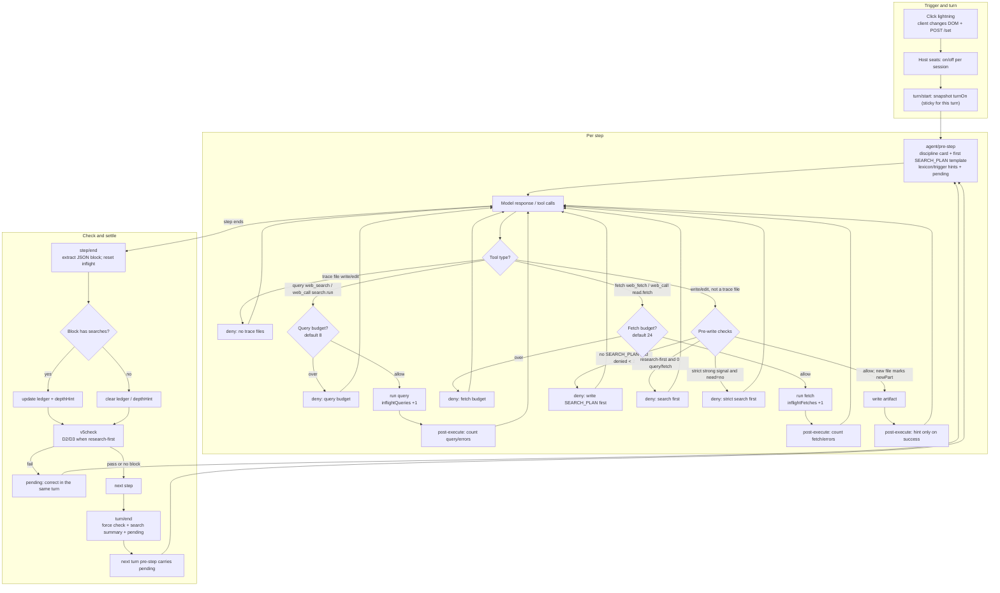

# dsh-deeper-think

**English** | [简体中文](README.md)

A DSH Desktop lightning toggle: when on, the model first decides whether to search and whether to search-before-build or build-before-search, then tries to falsify its answer with three necessary conditions (inventory, metamorphic, consistency); the host runs deterministic checks every step and pushes failures back into the same turn.

- Package: `dsh-deeper-think`
- Version: `0.1.18`
- Author: 七七 (Voyager77Twt)
- License: MIT
- Compatibility: DSH Desktop 0.2.x; Python 3 (tested 3.12) for the checker; Windows for the offline installer
- Tarball: `dsh-deeper-think-0.1.18.tgz` (generated by `npm pack` on every update)

> First read: Section 2 is the glossary and Section 3 is the complete flow. Start there; the field names will make sense afterwards.

## Contents

1. [Quick start](#1-quick-start)
2. [Glossary](#2-glossary)
3. [One diagram: after the lightning click](#3-one-diagram-after-the-lightning-click)
4. [Why: verification without an oracle](#4-why-verification-without-an-oracle)
5. [What it does](#5-what-it-does)
6. [Search: decision, enforcement, depth](#6-search-decision-enforcement-depth)
7. [Components of “more search”](#7-components-of-more-search)
8. [Checker rules](#8-checker-rules)
9. [Components and code](#9-components-and-code)
10. [Literature basis](#10-literature-basis)
11. [Evaluation](#11-evaluation)
12. [Install](#12-install)
13. [Packaging](#13-packaging)
14. [Repository layout](#14-repository-layout)
15. [Limitations and threat model](#15-limitations-and-threat-model)
16. [License](#16-license)
17. [References](#17-references)

---

## 1. Quick start

> `0.1.18` is an early internal build; the protocol and rules may still change. Test on a copy of your data and keep backups.

1. Settings → Plugins → install this package (plugin manager/marketplace), or run `install.ps1` offline;
2. Turn on the lightning next to the model selector;
3. Ask a question without a verifiable oracle, e.g. “check whether this UI state is consistent with the spec”;
4. Watch the injected `[dsh-deeper-think]` card, the `SEARCH_PLAN` prompt, and the `v5check: x/25–27` verdict at the start of the next turn;
5. To require a search on strong signals, set Settings → Deeper Think → Search → strict.

The plugin is active only while the switch is on; when off, DSH behaves exactly as before.

---

## 2. Glossary

| Term | What it means here |
|---|---|
| **oracle / ground truth** | An authority that can directly decide whether an answer is right (tests, reference answers, truth). Without it you can only falsify, not prove correctness. |
| **turn** | One complete interaction from a user message to the model's final answer. |
| **step** | One model response plus its tool-call loop inside a turn; each step ends at `step/end`. |
| **hook** | An event callback DSH exposes to plugins, e.g. `agent/pre-step`, `tools/pre-execute`, `tools/post-execute`, `session/event`. |
| **trace files** | `boundary.md`, `criteria.md`, `pre.md`, `acceptance.md`, `demo_runs.txt`, `settle.md`. v5 forbids them; evidence goes into the JSON block instead. |
| **structured block** | A JSON object in a ```json fence in the answer, with fields like `boundary`, `criteria`, `demos`, `searches`. |
| **`SEARCH_PLAN`** | One line the model writes before acting: `need / mode / budget / depth / why`. |
| **research-first** | Search before acting; the host denies `write/edit` until a real search/fetch is observed. |
| **build-first** | Reuse existing context first; writes are not blocked; a closing search is suggested. |
| **strict** | When the heuristic sees a strong signal, a real search is required even if the model wrote `need=no`. |
| **query / fetch** | A query is one `web_search` or `web_call search.run` (returns a result list); a fetch is `web_fetch` or `web_call read.fetch` (opens one article/URL). They are counted separately. |
| **search ledger (`searches`)** | The model's record after each search/fetch: `query/purpose/opened/excerpt/payload/not_covered`. |
| **depth (`purpose` / `depth`)** | The stage of this search: `orientation / targeted / cross-check / gap / saturation`. |
| **`not_covered`** | The model's self-report of what was not covered; the host only echoes it, never verifies it. |
| **`v5check`** | The deterministic Python checker with 29 rules; a common block emits 25–27. |
| **gate** | The host denies an operation before the tool runs and gives the model a reason. |
| **budget** | Per-turn query/fetch limits; defaults are 8 queries and 24 fetches. |
| **`pending`** | Text the host stores for the next step/turn, because hooks cannot rewrite the message just produced. |

---

## 3. One diagram: after the lightning click



### 3.1 Diagram-to-code map

| Node | Real location | Key condition |
|---|---|---|
| Lightning click | `lib/client.js` | Changes DOM only; POSTs `/dsh-deeper-think/set` |
| `seats` | `lib/index.js` | `sessionId → on`, in memory |
| `turn/start` | `lib/v5.js` | Copies `seats` into `turnOn`; clears per-turn search state |
| First `pre-step` | `lib/v5.js` | Injects discipline card, `SEARCH_PLAN` template, lexicon/trigger hints; reads only the real user message |
| Pre-write checks | `tools/pre-execute` | Trace deny, missing plan deny (up to 2), research-first no-search deny, strict strong-signal deny |
| Query/fetch budgets | `tools/pre-execute` | Query default 8, fetch default 24; parallel calls use in-flight reservation |
| Tool counting | `tools/post-execute` | Counts queries and fetches separately; errors go to `searchFails` |
| `step/end` | `lib/v5.js` | Extracts the block, updates ledger/depth, runs `v5check`, queues failures in `pending` |
| `turn/end` | `lib/v5.js` | Forces one more check; carries verdict, query/source counts, ledger state to the next turn |

### 3.2 Three phases

**Trigger**: the button only changes the switch; all working state lives in host memory and is cleared on restart.

**Per step**: the model gets the discipline card and `SEARCH_PLAN` template. Artifact writes pass through pre-write checks. Search tools are budgeted separately for queries and fetches, then counted.

**Check**: `step/end` extracts the JSON block and runs the checker; failures are pushed back into the next step of the same turn. `turn/end` is the fallback and carries the verdict to the next turn.

---

## 4. Why: verification without an oracle

When there is no oracle, “verify” cannot mean “compare with the correct answer”. It can only mean **falsification**: find a necessary condition that any correct result must satisfy, and check whether it is violated. A violation proves an error; satisfying the condition does not prove correctness (a one-sided test) [1].

Three families of necessary conditions have established engineering practice:

| Family | Necessary condition | Established method |
|---|---|---|
| Inventory | Everything required is present; nothing extra | Inspection checklists [8] |
| Metamorphic | A semantics-preserving transformation preserves a relation | Metamorphic testing [2], [3] |
| Consistency | Two representations of the same information agree | Differential testing [6]; N-version [7] |

The plugin also refuses to trust the model's self-report: self-correction without external feedback is unreliable [9], and iterative self-critique is weak [10]. The checker therefore runs **outside** the model, in the host.

---

## 5. What it does

- **Per-conversation switch**: lightning next to the model selector; default off, reset on restart.
- **Sticky per turn**: `turn/start` snapshots the switch; turning it off mid-turn does not break the turn.
- **Per-step discipline card**: ~300–500 tokens with the seven steps, three necessary conditions, block schema, and cost discipline.
- **No trace files**: denies six files such as `boundary.md`; artifacts still write normally.
- **Per-step verification**: `step/end` extracts the JSON block and runs `v5check` (up to 29 rules; 25–27 common); failures are corrected in the same turn.
- **Turn-end fallback**: missing block or remaining failure is carried to the next turn.
- **Truthful write hint**: “artifact written” only after a successful write.
- **Search decision**: the model writes `SEARCH_PLAN`; research-first has a write gate; strict is optional.
- **Settings**: search menu, custom triggers, version.

---

## 6. Search: decision, enforcement, depth

### 6.1 The model writes `SEARCH_PLAN` first

The first answer starts with one line:

```text
SEARCH_PLAN {"need":"yes|no","mode":"research-first|build-first","budget":1-8,"depth":"orientation|targeted|cross-check|gap|saturation","why":"…"}
```

- `need`: whether this turn needs external information;
- `mode`: search-before-build or build-before-search;
- `budget`: expected **query** count (not article count);
- `depth`: expected depth stage;
- `why`: one-line reason.

**Why a plan first**: mechanical rules only guess whether a task “looks like” it needs search; the model has read the task and can judge better. If the plan is missing, the first artifact write is denied (at most 2 times) with a prompt to add it, so a missed heuristic does not silently skip search.

### 6.2 Two modes + strict

- **research-first**: search before acting. The host denies `write/edit` until at least one real query or fetch is observed; the block must carry `searches` (`D2/D3`). After 4 denials with no search, it downgrades to build-first and records “not searched”.
- **build-first**: reuse existing context first; writes are not blocked; a closing search is suggested; the ledger is recommended, not required.
- **strict**: when the heuristic sees a strong signal (paper, latest, comparison, new implementation), a real query/fetch is required even if the model wrote `need=no`. Configurable in settings.

**How the mode is chosen**: the settings page does not pin a mode. Each turn the model picks in `SEARCH_PLAN.mode`; settings only choose auto/strict and trigger words; a user message saying “no search” overrides.

### 6.3 Settings and version

Settings → Deeper Think → Search:

- decision mode: auto (model) / strict (at least one search on strong signals);
- query ceiling: default 8;
- source-fetch ceiling: default 24;
- custom trigger words: one per line; a hit produces a one-time “you may search” hint; the model still decides;
- `vX.Y.Z` next to the title.

**Where the version comes from**: at startup the host reads the plugin's `package.json` and serves it via `/dsh-deeper-think/version`; the settings card fetches it and writes `vX.Y.Z` next to the title. It is not a hard-coded frontend constant, so it changes after a plugin update and restart; without a page refresh the old value may remain.

**Where config lives**: local `localStorage`; saving POSTs to `/dsh-deeper-think/config`; the client re-syncs it when a conversation opens. After a DSH restart, the client pushes the saved config to the host again.

### 6.4 Search ledger: who writes, who reads

`purpose` and `not_covered` are written by the **model** into the `searches` ledger; the host does not derive them. The host only:

1. extracts the ```json block;
2. checks that fields exist and lengths are legal (`D1/D3`);
3. echoes the `not_covered` **text** into the next prompt.

Example model entry:

```json
{"query":"dsh mcp official","purpose":"targeted","opened":"web_fetch https://...","excerpt":"...","payload":"L1-1","not_covered":"official doc not opened; 0.1.x differences unchecked"}
```

The host then says:

> Model-reported gap: official doc not opened; 0.1.x differences unchecked. If budget allows, search this gap.

So “what is uncovered” is the model's self-report. The host can check presence and length, **not truth**. Likewise `purpose` is a declared intent; the host cannot verify the actual progression.

### 6.5 Depth ladder

| Depth | Purpose | Typical action | Enter next when |
|---|---|---|---|
| `orientation` | Map the landscape: options/terms/versions | One broad query | Candidates or key terms appear |
| `targeted` | Pin the exact object: official docs, paper, repo, benchmark | Open the source with `web_fetch`; query by exact name/version | Citable text or data obtained |
| `cross-check` | Independent verification | Compare two sources; check dates/versions | Agreement, or a recorded disagreement |
| `gap` | Fill the gap | Search the missing part in `not_covered` | Gap cleared or marked unavailable |
| `saturation` | Saturation | Record “no new terms/sources” | Stop |

A concrete example: a broad query finds candidates (orientation); open the official doc by exact name (targeted); two sources disagree, so cross-check; write “old-version differences unchecked” into `not_covered` and search that gap; once no new terms appear, mark saturation.

Host nudges are templates, not understanding:

- non-empty `not_covered` (not “none”) → echo + follow-up suggestion;
- `purpose=orientation` → suggest targeted;
- `purpose=targeted` and `opened` only has a search tool → suggest `web_fetch` on the primary source;
- same `payload` already has two sources → suggest cross-check;
- `purpose=gap` with the gap cleared → suggest saturation;
- `purpose=saturation` → stop nudging;
- new file/dependency → suggest a targeted search for that part.

### 6.6 Budget: queries and fetches are separate

| Item | Counts | Default ceiling | Over-limit behavior |
|---|---|---|---|
| Query | `web_search`, `web_call search.run` | 8 | Deny new queries |
| Fetch | `web_fetch`, `web_call read.fetch` | 24 | Deny new sources |
| Action index | `web_index` | Not counted | Lists actions only |

**8 queries ≠ 8 articles**: one query returns a list; opening each article is a separate fetch. Reading 20 sources is not “20 searches”.

---

## 7. Components of “more search”

“Search more” is not one prompt; it is the sum of these parts:

| Part | What it does | Where | Enforced? |
|---|---|---|---|
| **Trigger hints** | Nudge on first action, lexicon hit, custom trigger, new file/dependency, unknown proper noun | `search-policy.js` / `v5.js` pre-step | Hint only |
| **Model decision** | Model writes `SEARCH_PLAN`: need / mode / budget / depth / why | First model answer | Drives the gate |
| **research-first gate** | With 0 queries and 0 fetches, deny `write/edit` | `tools/pre-execute` | Yes |
| **Tool-call observation** | Count `web_search` / `web_call` / `web_fetch` for gate and budget | `tools/post-execute` | Yes |
| **Search ledger** | `searches`: query / purpose / opened / excerpt / payload / not_covered | Structured block | Required in research-first |
| **Checker** | `D1` fields, `D2` required, `D3` quality | `v5check.py` | Failure corrected in-turn |
| **Depth nudges** | orientation→targeted, snippet→web_fetch, same payload→cross-check, gap→follow-up, saturation→stop | `depthHint` + pre-step | Hint only |
| **Budget** | Query 8, fetch 24, counted separately; warn at 80%, deny each above | `v5.js` | Hard ceilings |
| **Settings** | auto/strict, query ceiling, fetch ceiling, triggers, version | Settings → Deeper Think | User-adjustable |

In sequence: **hints** make search salient; **SEARCH_PLAN** lets the model choose a strategy; **gate + observation** guarantee at least one real search in research-first; **ledger + D2/D3** leave checkable fields; **depth nudges** push one search to the next stage; **budget** prevents runaway search; **settings** expose auto/strict, ceilings, and triggers. Remove any one and the behavior falls back to “search only if the model happens to remember”.

Together they raise the chance of “search once / search before writing”, but **do not guarantee broader coverage**: the host does not verify excerpts, `not_covered` is the model's self-report, and `purpose` is only a declaration.

---

## 8. Checker rules

`v5check.py` has 29 rules; a common block emits 25–27 (some are conditional). Each asks one simple question.

### 8.1 Boundary: did you say what “done” means?

- `B1` **Eight dimensions, at least six**: scope, quantifier, exceptions, priority, format, unit, definition, hidden dependencies. Example: not “count the users” but “all 12 rows, no exceptions, score 60 included”.
- `B2` **At least one ambiguity**: two readings, the difference, which one was chosen, why. Example: “60 counts as pass” vs “60 does not” differs by 2 rows.
- `B3` **Extra dimensions need a reason**: if you add a dimension beyond the eight, say why it matters here.

### 8.2 Necessary conditions: the core of no-oracle verification

- `A3-1` **Inventory**: list what must exist (source) and whether it exists (product). If the source cannot be enumerated, write `{"na":"reason"}`. Example: 8 required fields, 8 columns, none missing.
- `A5-1` **Metamorphic relation**: pick a change that should not change the answer (shuffle rows, scale the canvas), state the relation that must hold, record the actual result. Example: shuffle records → count stays 7.
- `A4-1` **Consistency**: compare two representations of the same fact. Example: count is 7 and the id list length is 7.

### 8.3 Criteria: what exactly are you checking?

- `T1` **Point to a concrete thing**: every criterion references an entity (`#id`, `id=`, a row/line), not “looks fine overall”.
- `T4` **Source shape**: a source must be a URL, “unverified”, or a derivation with a number (“derived 7=7”). Bare “standard practice” fails.
- `TOL` **Tolerance**: each criterion needs a tolerance with a number; missing or larger than 5 fails. Stops “±100 is fine”.
- `V1` **Definition scope**: if a criterion declares a scope, it cannot be vague (“whole file”, “all”). Say which part.
- `T3` **One demo per criterion**: every criterion id must appear in `demos`.
- `INV1` **Legal kind**: each criterion tagged inventory / metamorphic / consistency / boundary.
- `KIND1` **At least two of three**: among inventory, metamorphic, consistency, at least two are present.
- `A1` **Requirement coverage (optional)**: if `requirements` is present, each requirement must be claimed by existing criteria and every criterion must be claimed.
- `D1` **Search ledger (optional)**: if `searches` is present, each entry needs a query, what was opened, an excerpt, and what it supports.
- `D2` **Research mode needs a ledger**: with `--mode research-first`, `searches` must have at least one entry.
- `D3` **Ledger quality**: each entry needs `query` (≥4 chars, unique), `purpose` (one of five), `opened`, `excerpt` (10–300 chars), `payload`, and `not_covered`.

### 8.4 Demos: can this check actually fail?

- `N1` **The output must contain `FAIL`**: a demo that never fails proves the check is empty.
- `N2` **A crash is not a failure demo**: a traceback means the tool broke, not that the check detected a wrong answer.
- `N3` **Say what you broke**: each demo needs a non-empty `mutate`; restoring is good practice but **not** machine-checked.
- `DE1` **Concrete output**: the result must contain a number or error code; “it errored” is not enough.

### 8.5 Order and honesty: did it happen in the right order?

- `SR1` **Source shape again**: URLs must contain `http(s)://`; derived sources must contain a digit.
- `ORD1` **Criteria before artifact**: if you declare the order, criteria must precede the product — no tests written after seeing the answer.
- `CE1` **Claims need events**: if a criterion says “measured”, there must be a demo record.
- `CH1` **No idling**: if metrics give steps and claims, steps/claims ≤5.
- `SS1` **No self-scoring**: if the block says “everything passed”, demos must cover all criteria.
- `S1` **All green on the first try?** Then require at least 3 demos; one green demo is suspicious.
- `X1` **Three outside views**: if `outside` is present, fill user / adversary / maintainer; omit the whole section if not applicable — a partial section fails.
- `R5` **Fix what is fixable**: uncovered items are classified fixable / unfixable / external; the latter two need a reason; if anything is fixable, `repair` must be non-empty.

---

## 9. Components and code

| Component | Responsibility | Why it exists | How it is enforced |
|---|---|---|---|
| `lib/client.js` | Lightning, settings card, version, per-session state | Avoid React re-render churn and state drift | 11-item smoke test |
| `lib/index.js` | Host entry; HTTP `/set` `/config` `/version`; `seats` | Browser and model run in different processes | Route read-back, every set logged |
| `lib/v5.js` | Snapshot, discipline card, pre-write gate, query/fetch budgets, block extraction, checks, correction | The model cannot be trusted to check itself; DSH cannot rewrite the message just produced | Unit tests: sticky switch, in-turn correction, parallel budget, fetch budget |
| `lib/search-policy.js` | Parse `SEARCH_PLAN`, lexicon hints, depth hints, query/fetch detection | Keeps decision logic unit-testable instead of burying it in hooks | `search-depth`, `search-gate` |
| `lib/checkers/v5check.py` | 29 deterministic rules | A check that can fail is the difference between verification and ritual | Compliant sample; malformed inputs do not crash |
| `package.json` | Bundle/client declarations, `files` whitelist, `pack` script | Plugin manager install and packaging | Versioned generation |
| `cordis.patch.yml` | Bundle insertion row and search defaults | Standard DSH packaging | Profile bundle composition |
| `install.ps1` / `uninstall.ps1` | Offline fallback | Not every build has the marketplace path | Idempotent, backs up the patch layer |

---

## 10. Literature basis

The claim of this repository is deliberately modest: **for no-oracle tasks, forcing falsifiable necessary conditions and checking them externally should reduce silent errors per token spent.** The table maps each mechanism to its source and states the inference gap.

| Mechanism | Source | What the source establishes | What it does **not** establish |
|---|---|---|---|
| Inventory → `inventory` + `A3-1` | [8] | Checklists catch omissions in inspections | That an LLM follows a checklist; that the inventory is complete |
| Metamorphic relations → `invariants` + `A5-1` | [2], [3] | Relations serve as oracles without ground truth | That the chosen relation is strong enough |
| Mutation demos → `demos` + `N1/N2/N3/DE1` | [4], [5] | Mutants test whether tests detect faults; equivalent mutants are a limit | That a textual “FAIL” equals a real mutation run (the host does not re-execute) |
| Cross-artifact consistency → `consistency` + `A4-1` | [6], [7] | Independent representations expose disagreements | That the two representations are independent |
| External checker + same-turn correction | [9], [10] | Self-correction without external feedback is unreliable; iterative self-critique is weak | That this checker is strong enough; that the model accepts the correction |
| Structured self-verification block | [11] | Backward verification with structured questions improves reasoning scores | That structured blocks alone improve factual correctness |
| Deterministic rules instead of an LLM judge | [12] | LLM judges show position, verbosity, and self-enhancement biases | That rule-based checks are unbiased or ungameable |
| Not equating “all checks pass” with quality | [13] | Over-optimizing a proxy degrades the true objective (Goodhart) | That this plugin avoids Goodhart |
| Threat model: anti-laziness, not anti-adversary | [14] | Monitoring protocols must be evaluated against intentional subversion | That this plugin resists deliberate gaming |
| Spending test-time compute | [15] | Test-time compute helps, but allocation should adapt to difficulty | That a fixed protocol is compute-optimal |
| Effort over tool access | [16] (observational) | Observed association between effort and first-try reliability | That this plugin raises effort or transfers to other tasks |

These sources support **components** in related settings; none evaluates this plugin end-to-end. The end-to-end claim remains a hypothesis supported by mechanism and small-scale measurements.

---

## 11. Evaluation

### 11.1 Cost A/B

Small task (median + population SD), fresh sub-sessions, baseline first:

| Version | Baseline tokens | v5 tokens | Ratio |
|---|---|---|---|
| 0.1.5 | 47,335 | 106,551 | 2.25× |
| 0.1.7 | 109,072 | 128,109 | 1.17× |
| 0.1.8 | 194,906 | 125,152 | 0.64× |
| 0.1.9 | 107,577 | 124,932 | 1.16× |

Four runs are ≤3×. One corrected-compliance run reached **3.82×** (10 calls, 416,157 tokens vs 109,072) because two failed checks triggered rework loops; recorded honestly.

### 11.2 Search tendency (small sample)

| Task | Baseline | Plugin | Note |
|---|---|---|---|
| Is MCP official? | 2 queries + 8 sources, 363,091 | 2 + 2, 425,376 (1.17×) | Same queries; the old budget charged sources too, so fetches were capped at 2 |
| FizzBuzz + latest best practices | 0 web, 188,865 | auto: 1 query, 124,450 (0.66×) | Searched PEP 649 first |
| Same, strict mode | 0 web, 188,865 | 2 queries (1 error), 162,913 (0.86×) | Forced to search before writing |

Since 0.1.18, queries and fetches are counted separately: “2 + 8” means **2 queries + 8 sources**, not 10 queries. The old version charged fetches to the same budget, which capped the plugin run at 2 sources.

Conclusion: strict mode shows a clear “search more” sign; auto mode also searches, but does not guarantee it. The sample is small and is not a quality comparison. Details: [docs/SEARCH_TENDENCY.md](docs/SEARCH_TENDENCY.md).

### 11.3 Compliance

- Compliant sample: 25/25;
- Legacy block without the three sections: 20/25 (`A3-1`, `A5-1`, `A4-1`, `INV1`, `KIND1`);
- Field runs: `v5 check (step): 23/25 T4,N1`, `24/25 T4` — the checker ran and injected failures; the model did not always fix them.

**Not measured**: answer quality at scale, statistical significance, cross-model replication, long-horizon tasks.

---

## 12. Install

Recommended: DSH Desktop → Settings → Plugins → install this package (plugin manager/marketplace); then disable or remove it under Installed.

Offline fallback: `pwsh -File .\install.ps1` copies the package to `profiles/web/vendor/` and appends a row to `cordis.patch.yml`. Do not use both paths at once.

The checker requires Python (`python` / `py` / `python3`, or `DSH_DEEPER_THINK_PYTHON` / config `pythonPath`). Without Python the checker is skipped and the host reports “not run”, not a silent pass.

---

## 13. Packaging

After every plugin update:

```bash
npm run pack
```

Output: `dsh-deeper-think-<version>.tgz`. Current `0.1.18`, placed in `dist/`; it contains `lib/`, `docs/`, README, install scripts, and `package.json`. The tarball is for backup/distribution/Docker builds; the DSH plugin manager still installs from the directory.

Why `.tgz`: the DSH plugin manager installs from a directory, but a directory changes with the workspace; the tarball is an immutable version snapshot for backup, distribution, Docker builds, and rollback. A `files` whitelist keeps runtime files only and excludes legacy `lib/policy.js`.

Verify with `tar -tf dsh-deeper-think-<version>.tgz` and `tar -xOf ... package/package.json` (version, scripts, files).

---

## 14. Repository layout

```text
dsh-deeper-think/
├─ lib/
│  ├─ client.js          # lightning, settings card, version
│  ├─ index.js           # host entry, /set /config /version
│  ├─ v5.js              # snapshot, gates, query/fetch budgets, checks
│  ├─ search-policy.js   # SEARCH_PLAN, lexicon, depth hints, query/fetch
│  └─ checkers/
│     └─ v5check.py      # 29 rules
├─ docs/
│  ├─ PLUGIN_EXPLAINED.md # component-level rationale
│  ├─ COST_TRIALS.md      # cost measurements
│  ├─ SEARCH_TENDENCY.md  # search-tendency A/B
│  └─ TASK_detect_v5.md   # reproducible detection task
├─ cordis.patch.yml
├─ package.json
├─ dsh-deeper-think-0.1.18.tgz
├─ install.ps1 / uninstall.ps1
├─ HOST_WIRING.md
├─ LICENSE
└─ README.md / README.en.md
```

---

## 15. Limitations and threat model

- **Draft first**: DSH exposes no hook to intercept an assistant message before it is shown. Checking happens at `step/end`; the model may finish without applying the correction. The failure is recorded and carried to the next turn, but the current answer has already been shown.
- **Block-only**: the checker sees the structured block, not the prose.
- **Textual demos**: the host does not re-execute `demos[].actual`; it validates shape and concreteness only. Mutation testing's real strength (executing mutants) is only partially realized.
- **Goodhart risk**: a model can learn to write blocks that pass rules without improving the answer; `uncovered`, `X1`, and “all-pass ≠ quality” mitigate but do not eliminate it.
- **The gate covers write/edit only**: `bash` or scripts that write files are not blocked; research-first can still be bypassed.
- **Not anti-adversarial**: the threat model is laziness/sloppiness, not intentional subversion [14].
- **Python dependency** and **DSH version coupling** (`agent/pre-step`, `tools/pre-execute`, `tools/post-execute`, `session/event`).

---

## 16. License

MIT — see [LICENSE](LICENSE).

---

## 17. References

[1] K. R. Popper, *The Logic of Scientific Discovery*. London, U.K.: Hutchinson, 1959.

[2] T. Y. Chen, S. C. Cheung, and S. M. Yiu, “Metamorphic testing: A new approach for generating next test cases,” Dept. Comput. Sci., Hong Kong Univ. Sci. Technol., Hong Kong, Tech. Rep. HKUST-CS98-01, 1998.

[3] S. Segura, G. Fraser, A. B. Sanchez, and A. Ruiz-Cortés, “A survey on metamorphic testing,” *IEEE Trans. Softw. Eng.*, vol. 42, no. 9, pp. 923–947, Sep. 2016, doi: 10.1109/TSE.2016.2532875.

[4] R. A. DeMillo, R. J. Lipton, and F. G. Sayward, “Hints on test data selection: Help for the practicing programmer,” *Computer*, vol. 11, no. 4, pp. 34–41, Apr. 1978, doi: 10.1109/C-M.1978.218136.

[5] Y. Jia and M. Harman, “An analysis and survey of the development of mutation testing,” *IEEE Trans. Softw. Eng.*, vol. 37, no. 5, pp. 649–678, Sep.–Oct. 2011, doi: 10.1109/TSE.2010.62.

[6] W. M. McKeeman, “Differential testing for software,” *Digital Technical Journal*, vol. 10, no. 1, pp. 100–107, 1998.

[7] A. Avizienis, “The N-version approach to fault-tolerant software,” *IEEE Trans. Softw. Eng.*, vol. SE-11, no. 12, pp. 1491–1501, Dec. 1985.

[8] M. E. Fagan, “Design and code inspections to reduce errors in program development,” *IBM Systems Journal*, vol. 15, no. 3, pp. 182–211, 1976, doi: 10.1147/sj.153.0182.

[9] J. Huang, X. Chen, S. Mishra, H. S. Zheng, A. W. Yu, X. Song, and D. Zhou, “Large language models cannot self-correct reasoning yet,” arXiv:2310.01798, 2023. [Online]. Available: https://arxiv.org/abs/2310.01798

[10] K. Stechly, M. Marquez, and S. Kambhampati, “GPT-4 doesn't know it's wrong: An analysis of iterative prompting for reasoning problems,” arXiv:2310.12397, 2023. [Online]. Available: https://arxiv.org/abs/2310.12397

[11] Y. Weng, M. Zhu, F. Xia, B. Li, S. He, S. Liu, B. Sun, K. Liu, and J. Zhao, “Large language models are better reasoners with self-verification,” arXiv:2212.09561, 2022. [Online]. Available: https://arxiv.org/abs/2212.09561

[12] L. Zheng, W.-L. Chiang, Y. Sheng, S. Zhuang, Z. Wu, Y. Zhuang, Z. Lin, Z. Li, D. Li, E. P. Xing, H. Zhang, J. E. Gonzalez, and I. Stoica, “Judging LLM-as-a-judge with MT-Bench and Chatbot Arena,” arXiv:2306.05685, 2023. [Online]. Available: https://arxiv.org/abs/2306.05685

[13] L. Gao, J. Schulman, and J. Hilton, “Scaling laws for reward model overoptimization,” arXiv:2210.10760, 2022. [Online]. Available: https://arxiv.org/abs/2210.10760

[14] R. Greenblatt, B. Shlegeris, K. Sachan, and F. Roger, “AI control: Improving safety despite intentional subversion,” arXiv:2312.06942, 2023. [Online]. Available: https://arxiv.org/abs/2312.06942

[15] C. Snell, J. Lee, K. Xu, and A. Kumar, “Scaling LLM test-time compute optimally can be more effective than scaling model parameters,” arXiv:2408.03314, 2024. [Online]. Available: https://arxiv.org/abs/2408.03314

[16] “Reasoning effort, not tool access, buys first-try reliability in agentic code generation: An observational study,” arXiv:2607.02436, 2026. [Online]. Available: https://arxiv.org/abs/2607.02436
