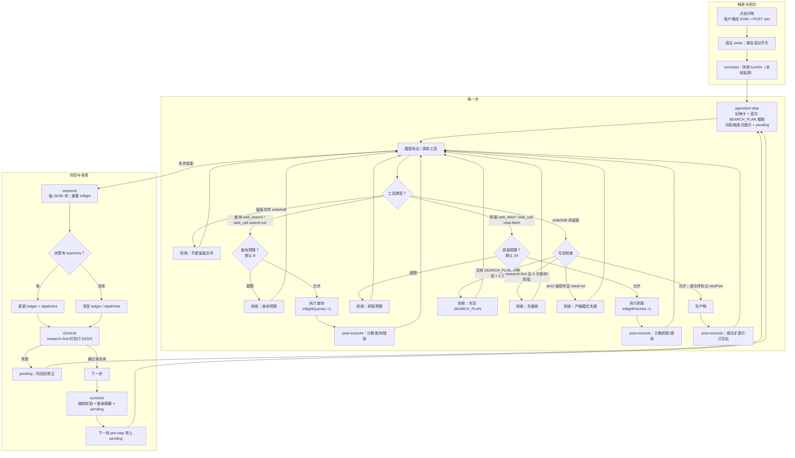

# dsh-deeper-think

[English](README.en.md) | **简体中文**

给 DSH Desktop 加一个闪电开关：开启后，模型先判断“要不要搜、先搜还是先做”，再用清点、变质、一致三类必要条件证伪；宿主用确定性检查器逐步校验，并把失败甩回同一回合。

- 包名：`dsh-deeper-think`
- 版本：`0.1.18`
- 作者：七七（Voyager77Twt）
- 许可：MIT
- 兼容：DSH Desktop 0.2.x；检查器需要 Python 3（实测 3.12）；离线安装脚本面向 Windows
- 发布包：`dsh-deeper-think-0.1.18.tgz`（每次更新由 `npm pack` 生成）

> 第一次读：第 2 节是术语表，第 3 节是一张完整流程图，先看这两节，后面就不会被字段名绊住。

## 目录

1. [快速开始](#1-快速开始)
2. [术语表](#2-术语表)
3. [一张图看懂：按下闪电之后](#3-一张图看懂按下闪电之后)
4. [为什么：没有标准答案时怎么验](#4-为什么没有标准答案时怎么验)
5. [它做什么](#5-它做什么)
6. [检索：判断、强制、深度](#6-检索判断强制深度)
7. [多搜的组成部分](#7-多搜的组成部分)
8. [检查器规则](#8-检查器规则)
9. [部件与代码](#9-部件与代码)
10. [文献依据](#10-文献依据)
11. [评估](#11-评估)
12. [安装](#12-安装)
13. [打包与分发](#13-打包与分发)
14. [目录](#14-目录)
15. [限制与威胁模型](#15-限制与威胁模型)
16. [许可证](#16-许可证)
17. [参考文献](#17-参考文献)

---

## 1. 快速开始

> `0.1.18` 是内测早期版本，协议和规则仍可能调整。先在资料副本上测试并保留备份。

1. 设置 → 插件 → 安装本包（插件管理器/商城通道），或离线运行 `install.ps1`；
2. 点亮模型选择器左侧的闪电；
3. 提一个没有可验证标准答案的问题，例如“检查这个界面状态是否与规格一致”；
4. 观察注入的 `[dsh-deeper-think]` 卡片、`SEARCH_PLAN` 提示，以及下一轮开头的 `v5check：x/25–27` 结论；
5. 需要强信号必搜时，在设置 → 更深思考 → 搜索里把判断方式改为“严格”。

插件只在开关打开时生效；关闭时 DSH 行为与之前一致。

---

## 2. 术语表

| 术语 | 在这里是什么意思 |
|---|---|
| **oracle / 标准答案** | 能直接判断答案对错的权威来源（测试、参考答案、真值）。没有它时只能“证伪”，不能“证明对”。 |
| **回合（turn）** | 用户发一条消息到模型最终回答之间的一次完整交互。 |
| **步（step）** | 回合内模型的一次响应 + 工具调用循环；每一步结束会触发 `step/end`。 |
| **钩子（hook）** | DSH 暴露给插件的事件回调，例如 `agent/pre-step`、`tools/pre-execute`、`tools/post-execute`、`session/event`。 |
| **留痕文件** | `boundary.md`、`criteria.md`、`pre.md`、`acceptance.md`、`demo_runs.txt`、`settle.md`。v5 不允许写这些，证据只进回答里的 JSON 块。 |
| **结构化块** | 回答里用 ```json 包起来的一个对象，包含 `boundary`、`criteria`、`demos`、`searches` 等字段。 |
| **`SEARCH_PLAN`** | 模型在动手前写的一行计划：`need / mode / budget / depth / why`。 |
| **research-first（主搜索）** | 先搜再动手；宿主在观测到真实搜索/抓取前拒绝 `write/edit`。 |
| **build-first（主动手）** | 沿用已有上下文先做；不拦写，写后提醒补搜。 |
| **strict（严格）** | 启发式看到强信号时，即使模型写 `need=no`，也要求至少一次真实搜索后才放行写。 |
| **查询 / 抓取** | 查询是一次 `web_search` 或 `web_call search.run`（返回一批结果）；抓取是 `web_fetch` 或 `web_call read.fetch`（打开一篇文章/URL）。两者分开计数。 |
| **检索账本（`searches`）** | 每次搜索/抓取后模型写进块里的记录：`query/purpose/opened/excerpt/payload/not_covered`。 |
| **深度（`purpose` / `depth`）** | 本次检索在哪个阶段：`orientation / targeted / cross-check / gap / saturation`。 |
| **`not_covered`** | 模型自报“这次没覆盖什么”；宿主只回显，不验证真伪。 |
| **`v5check`** | Python 确定性检查器，对结构化块跑 29 条规则；常见块发出 25–27 条。 |
| **闸门（gate）** | 宿主在工具执行前拒绝某个操作，并给模型理由。 |
| **预算** | 每回合允许的查询/抓取次数；查询默认 8，抓取默认 24。 |
| **`pending`** | 宿主记下“下一步/下一轮要贴给模型的话”，因为钩子改不了刚生成的消息。 |

---

## 3. 一张图看懂：按下闪电之后



### 3.1 图和代码怎么对应

| 图中节点 | 真实位置 | 关键条件 |
|---|---|---|
| 点击闪电 | `lib/client.js` | 只改 DOM，POST `/dsh-deeper-think/set` |
| `seats` | `lib/index.js` | `sessionId → on`，内存态 |
| `turn/start` | `lib/v5.js` | 把 `seats` 抄进 `turnOn`；清空本回合检索状态 |
| 第一次 `pre-step` | `lib/v5.js` | 注入纪律卡、`SEARCH_PLAN` 模板、词表/触发词提示；只取真实用户消息 |
| 写前检查 | `tools/pre-execute` | 留痕拒绝、计划没写先拒（最多 2 次）、research-first 未搜先拒、strict 强信号拒 |
| 查询/抓取预算 | `tools/pre-execute` | 查询默认 8、抓取默认 24；并行调用用 inflight 占位 |
| 工具计数 | `tools/post-execute` | 查询/抓取分别计数；错误计入 `searchFails` |
| `step/end` | `lib/v5.js` | 抽块、更新账本/深度、跑 `v5check`、失败进 `pending` |
| `turn/end` | `lib/v5.js` | 强制再查一次，把结论、查询/来源次数、账本状态带到下一轮 |

### 3.2 三个阶段

**触发**：按钮只负责开关；真正的工作状态都在宿主内存里，重启即清空。

**每一步**：模型先拿纪律卡和 `SEARCH_PLAN` 模板；如果要写产物，先过写前检查。搜索工具按查询/抓取分别预算，执行后计数。

**校验**：`step/end` 从回答里抽 JSON 块，跑检查器；失败就在同一回合下一步贴回去。`turn/end` 再兜底一次，把结论带到下一轮。

---

## 4. 为什么：没有标准答案时怎么验

没有 oracle 时，“验证”不可能是“和正确答案比对”，只能是**证伪**：找一个任何正确结果都必须满足的必要条件，看它有没有被违反。违反 ⇒ 必然错；满足 ⇒ 不能说明对（单侧检验）[1]。

工程上成熟的三类必要条件：

| 类别 | 必要条件 | 成熟方法 |
|---|---|---|
| 清点 | 该有的都在，不该有的没有 | 审查检查单 [8] |
| 变质 | 不改变语义的变换必须保持某个关系 | 变质测试 [2]、[3] |
| 一致 | 同一信息的两种表示必须相等 | 差分测试 [6]；N 版本 [7] |

插件也不相信模型的自述：无外部反馈时自我纠错不可靠 [9]，迭代自我批评效果也弱 [10]。所以检查器放在**模型之外**、宿主之内。

---

## 5. 它做什么

- **按会话开关**：模型选择器左侧闪电；默认关，重启复位。
- **回合粘滞**：`turn/start` 快照开关；中途关掉不影响本轮。
- **每步纪律卡**：约 300–500 token，含七步流程、三件套、块格式、成本纪律。
- **不留痕文件**：拒绝 `boundary.md` 等 6 个文件；产物照常落盘。
- **每步校验**：`step/end` 抽 JSON 块，跑 `v5check`（最多 29 条，常见 25–27），失败同回合修正。
- **回合末兜底**：没块或仍失败，结论带到下一轮。
- **不假报**：只有写入成功才提示“产物已写出”。
- **检索判断**：模型写 `SEARCH_PLAN`；research-first 有写前闸门；strict 可选。
- **设置页**：搜索菜单、自定义触发词、版本号。

---

## 6. 检索：判断、强制、深度

### 6.1 模型先写 `SEARCH_PLAN`

第一次回答先写一行：

```text
SEARCH_PLAN {"need":"yes|no","mode":"research-first|build-first","budget":1-8,"depth":"orientation|targeted|cross-check|gap|saturation","why":"…"}
```

- `need`：这一轮要不要外部信息；
- `mode`：先搜后写，还是先写后补搜；
- `budget`：预计的**查询**次数（不是文章数）；
- `depth`：预计的深度阶段；
- `why`：一句话理由。

**为什么先写计划**：机械规则只能猜“这个任务像不像需要搜”，模型读过任务，判断更细。计划缺失时，第一次写产物会被拒（最多拒 2 次）并提示补计划；这样不会因为规则漏判就完全跳过检索。

### 6.2 两种模式 + strict

- **research-first（主搜索）**：先搜再动手。宿主在观测到至少 1 次真实查询或抓取前，拒绝 `write/edit`；块里必须有 `searches`（`D2/D3`）。连续 4 次被拒且没搜，降级为 build-first，并在结论里写明“未检索”。
- **build-first（主动手）**：沿用已有上下文先做；不拦写，写后提醒补搜；账本建议填，不强制。
- **strict（严格）**：启发式看到强信号（论文、最新、选型、实现新目标等）时，即使模型写 `need=no`，也要求至少一次真实查询/抓取后才放行写。设置页可切。

**怎么切换**：设置页不固定模式。每回合模型在 `SEARCH_PLAN.mode` 里现场选；设置页只决定“自动/严格”和触发词；用户消息里写“不用搜”可覆盖。

### 6.3 设置页与版本号

设置 → 更深思考 → 搜索：

- 判断方式：自动（模型判断）/ 严格（强信号至少搜一次）；
- 检索查询上限：默认 8；
- 来源抓取上限：默认 24；
- 自定义触发词：每行一个；用户输入命中时提示一次“可以搜索”，是否搜仍由模型判断；
- 标题旁显示 `vX.Y.Z`。

**版本号从哪来**：宿主启动时读插件根目录的 `package.json`，通过 `/dsh-deeper-think/version` 返回；设置卡拉取后写入标题旁。不是前端写死的常量，所以插件更新并重启后会自动变化；页面没刷新时可能仍显示旧值。

**配置存哪**：本机 `localStorage`，保存时 POST 到宿主 `/dsh-deeper-think/config`；打开对话时自动同步。重启 DSH 后，客户端会把已保存的配置重新推给宿主。

### 6.4 检索账本：谁写、谁读

`purpose` 和 `not_covered` 都是**模型写进 `searches` 账本**的，不是宿主分析出来的。宿主只做三件事：

1. 从回答里抽 ```json 块；
2. 检查字段在不在、长度合不合规（`D1/D3`）；
3. 把 `not_covered` 的**原文**拼进下一步提示。

例如模型写：

```json
{"query":"dsh mcp 官方","purpose":"targeted","opened":"web_fetch https://...","excerpt":"...","payload":"L1-1","not_covered":"官方文档原文没打开；0.1.x 旧版差异未查"}
```

宿主下一步只会说：

> 模型自报未覆盖：官方文档原文没打开；0.1.x 旧版差异未查。预算允许时可补搜这个缺口。

所以“未覆盖什么”来自模型自述；宿主能查“有没有写、写得够不够具体”，**不能查“写得对不对”**。同理，`purpose` 只是模型声明的意图，宿主不能验证它真的先宽后窄。

### 6.5 深度阶梯

| 深度 | 目的 | 典型动作 | 进入下一层的信号 |
|---|---|---|---|
| `orientation` | 摸清地形：有哪些方案/术语/版本 | 1 次宽查询 | 出现候选方案或关键术语 |
| `targeted` | 锁定精确对象：官方文档、论文、仓库、benchmark | 用 `web_fetch` 打开原文；query 用精确名/版本 | 拿到可引用的原文或数据 |
| `cross-check` | 交叉验证 | 对比 2 个独立来源；查发布日期/版本 | 结论一致，或记录分歧 |
| `gap` | 补缺口 | 针对 `not_covered` 里没查的部分再搜 | 缺口清空或判定“不可得” |
| `saturation` | 饱和 | 记录“已无新词/新来源” | 停止 |

一个具体例子：先宽搜“DSH 插件 搜索”拿到候选（orientation）；再用精确名打开官方文档（targeted）；发现两个来源版本不一致，做 cross-check；把“旧版差异没查”写进 `not_covered`，再补一次（gap）；确认没有新术语后写 saturation 收尾。

宿主按账本推送的提示（模板，不是理解）：

- `not_covered` 非空且不是“无” → 原文回显 + 补搜建议；
- `purpose=orientation` → 提示进入 targeted；
- `purpose=targeted` 且 `opened` 只有搜索工具 → 提示用 `web_fetch` 打开主来源；
- 同一 `payload` 已有两个来源 → 提示 cross-check；
- `purpose=gap` 且缺口清空 → 提示可标 saturation；
- `purpose=saturation` → 不再催；
- 写新文件/改依赖 → 提示对新部件做 targeted。

### 6.6 预算：查询和抓取分开

| 项目 | 计什么 | 默认上限 | 超限行为 |
|---|---|---|---|
| 查询 | `web_search`、`web_call search.run` | 8 | 拒绝新的查询 |
| 抓取 | `web_fetch`、`web_call read.fetch` | 24 | 拒绝打开新来源 |
| 动作索引 | `web_index` | 不计 | 只列可用动作 |

**8 次查询 ≠ 8 篇文章**：一次查询返回一批结果；打开每篇文章是另一个“抓取”计数。这样读 20 个来源不会被误判成“搜了 20 次”。

---

## 7. 多搜的组成部分

“让模型多搜”不是一句提示，而是以下部件叠加出来的倾向：

| 组成 | 做什么 | 在哪 | 是否强制 |
|---|---|---|---|
| **触发提示** | 首次动手、词表命中、自定义触发词、新文件/依赖、未知专名时提醒“可以搜” | `search-policy.js` / `v5.js` pre-step | 提示，不强制 |
| **模型决策** | 模型写 `SEARCH_PLAN`：need / mode / budget / depth / why | 模型第一条回答 | 决定后续闸门 |
| **research-first 闸门** | 0 次查询且 0 次抓取时，拒绝 `write/edit` | `tools/pre-execute` | 强制 |
| **真实调用观测** | 记录 `web_search` / `web_call` / `web_fetch`，用于闸门与预算 | `tools/post-execute` | 强制计数 |
| **检索账本** | `searches`：query / purpose / opened / excerpt / payload / not_covered | 结构化块 | research-first 必填 |
| **检查器** | `D1` 字段、`D2` 必填、`D3` 质量 | `v5check.py` | 失败同回合修正 |
| **深度提示** | orientation→targeted、摘要→web_fetch、同判据→cross-check、缺口→补搜、saturation→停 | `depthHint` + pre-step | 提示，不强制 |
| **预算** | 查询 8、抓取 24，分开计数；80% 提醒，超限各自拒绝 | `v5.js` | 强制上限 |
| **设置页** | 自动/严格、查询上限、抓取上限、触发词、版本号 | 设置 → 更深思考 | 用户可调 |

串起来看：**提示**让模型想到搜；**SEARCH_PLAN** 让模型自己定策略；**闸门 + 观测**保证 research-first 至少真的搜一次；**账本 + D2/D3** 让搜索留下可检查的字段；**深度提示**把一次搜索往下一层推；**预算**防止无限搜；**设置页**让用户调自动/严格、上限、触发词。任何一环缺失，效果都会退化成“模型想起来才搜”。

这些加起来能提高“搜一次/先搜后写”的概率，但不保证“搜得更全”：宿主不验证摘录真伪，`not_covered` 是模型自述，`purpose` 只是声明。

---

## 8. 检查器规则

`v5check.py` 一共 29 条规则，常见块发出 25–27 条（部分规则条件触发）。每条只问一个简单问题。

### 8.1 边界：有没有说清“做完”是什么样

- `B1` **八维至少写六个**：范围、量词、例外、优先级、格式、单位、口径、隐含依赖。例：不要写“统计用户”，要写“全部 12 行、无例外、含 60 分”。
- `B2` **至少写一组歧义**：同一句话的两种读法、差多少、采用哪个、为什么。例：“60 算及格”与“60 不算”差 2 条。
- `B3` **自己加的维度要写理由**：超出八维的维度，说明为什么这里需要。

### 8.2 必要条件：无标准答案时的核心

- `A3-1` **清点**：源里该有什么、产物里有没有，逐项对。源不可枚举就写 `{"na":"原因"}`。例：要求 8 个字段，表里正好 8 列，一个不少。
- `A5-1` **变质**：选一个不该改变答案的改动（打乱行序、放大画布），写出必须保持的关系，再写实测结果。例：打乱记录后计数仍是 7。
- `A4-1` **一致**：同一事实的两种表示要对账。例：数字写 7，id 列表长度也应是 7。

### 8.3 判据：到底在查什么

- `T1` **引用实体**：每条判据要指向具体对象（`#id`、`id=`、某行/某段），不能写“整体看起来对”。
- `T4` **来源形状**：来源只能是 URL、“未核”、或带数字的推导（“推导 7=7”）。只写“标准做法”不算。
- `TOL` **容差**：每条要给带数字的容差；漏写或大于 5 判失败，防止“±100 都算对”。
- `V1` **定义域**：写了定义域就不能含糊（“整个文件”“全部”），要说清哪一部分。
- `T3` **每条判据有演示**：每个判据 id 都要在 `demos` 里出现。
- `INV1` **合法 kind**：每条判据标成 清点 / 变质 / 一致 / 边界。
- `KIND1` **三类至少覆盖两类**：清点、变质、一致里至少出现两类。
- `A1` **需求点认领（可选）**：提供了 `requirements` 时，每条需求要由已有判据认领，且每条判据都要被某条需求认领。
- `D1` **检索账本（可选）**：提供了 `searches` 时，每条要写检索式、打开了什么、原文摘录、支撑哪条判据。
- `D2` **研究型必须有账本**：`--mode research-first` 时 `searches` 至少 1 条，缺了直接失败。
- `D3` **账本质量**：每条要有 `query`（≥4 字、不重复）、`purpose`（五个之一）、`opened`、`excerpt`（10–300 字）、`payload`、`not_covered`。

### 8.4 演示：这个检查真的会失败吗

- `N1` **actual 里要有 `FAIL`**：从不失败的演示说明检查是空的。
- `N2` **崩溃不算失败演示**：报 Traceback 说明工具坏了，不是检查抓到了错。
- `N3` **写清改坏了什么**：每条演示的 `mutate` 不能为空；复原是好习惯，但检查器**不**验证复原。
- `DE1` **actual 要具体**：得有数字或错误码；只写“报错了”不算。

### 8.5 顺序与诚实：是不是按顺序做的

- `SR1` **来源形状**：URL 必须含 `http(s)://`；推导来源必须含数字。
- `ORD1` **判据先于产物**：声明了顺序，就必须先写判据再动手，不能看到答案再补测试。
- `CE1` **声称要有事件**：判据里写“实测”，就必须有对应演示记录。
- `CH1` **无空转**：给了步数和断言数时，步数/断言数 ≤5。
- `SS1` **不许自评**：块里写“已全部通过”，演示就必须覆盖全部判据，否则算自我打分。
- `S1` **首轮全绿要 ≥3 条演示**：一次就全过，只给 1 条演示很可疑。
- `X1` **表外三问**：如果写了 `outside`，三个视角（使用者/对抗者/维护者）都要填；确实不适用就整节省略，填一半算失败。
- `R5` **可修必修**：未覆盖项要分类为 可修/不可修/需外部；后两类要写原因；有“可修”时 `repair` 不能为空。

---

## 9. 部件与代码

| 部件 | 职责 | 为什么存在 | 如何保证 |
|---|---|---|---|
| `lib/client.js` | 闪电按钮、设置卡、版本号、按会话状态 | 避免 React 重渲染与状态漂移 | 冒烟 11 项 |
| `lib/index.js` | 宿主入口；HTTP `/set` `/config` `/version`；`seats` | 浏览器与模型进程隔离 | 路由回读、每次 set 记日志 |
| `lib/v5.js` | 快照、纪律卡、写前闸门、查询/抓取预算、抽块、校验、修正 | 不能信模型自查；DSH 改不了刚生成的消息 | 单测：粘滞、同回合修正、并行预算、抓取预算 |
| `lib/search-policy.js` | 解析 `SEARCH_PLAN`、词表提示、深度提示、查询/抓取判定 | 判断逻辑可单测，不塞进钩子 | `search-depth`、`search-gate` |
| `lib/checkers/v5check.py` | 29 条确定性规则 | 能失败的检查才是验证 | 合规样例、畸形输入不崩 |
| `package.json` | bundle/client 声明、`files` 白名单、`pack` 脚本 | 插件管理器安装与打包 | 版本化生成代 |
| `cordis.patch.yml` | bundle 插入行与搜索默认值 | DSH 标准打包 | profile bundle 组合 |
| `install.ps1` / `uninstall.ps1` | 离线兜底 | 并非所有构建都有商城通道 | 幂等、备份补丁层 |

---

## 10. 文献依据

本仓库的主张是克制的：**在无 oracle 任务上，强制可证伪的必要条件并用外部检查，应当降低“每花一份 token 就悄悄出错”的概率。** 下表逐条对应，并写明推断缺口。

| 机制 | 文献 | 文献建立了什么 | 不能建立什么 |
|---|---|---|---|
| 清点 → `inventory` + `A3-1` | [8] | 审查检查单能抓遗漏 | 模型会照做；清单本身完整 |
| 变质关系 → `invariants` + `A5-1` | [2]、[3] | 关系可在无真值时充当判据 | 选的关系足够强 |
| 变异演示 → `demos` + `N1/N2/N3/DE1` | [4]、[5] | 变异体能检验测试是否抓错；等价变异体是边界 | 文本“FAIL”等于真的跑过变异（宿主不重跑） |
| 跨产物一致 → `consistency` + `A4-1` | [6]、[7] | 独立表示的分歧能暴露错误 | 两份表示真的独立 |
| 外部检查 + 同轮修正 | [9]、[10] | 无外部反馈自我纠错不可靠；迭代自评弱 | 本检查器足够强；模型会接受修正 |
| 结构化自验证块 | [11] | 带结构化问题的后向验证能提升推理分数 | 结构化块本身能保证事实正确 |
| 用确定性规则而非 LLM 判官 | [12] | LLM 判官有位置/冗长/自偏好偏差 | 规则检查无偏、不可被套路 |
| 不把“全过”当质量 | [13] | 过度优化代理指标会伤害真实目标 | 插件能避免 Goodhart |
| 威胁模型：防懒不防恶 | [14] | 监控协议必须按“故意颠覆”评估 | 插件能抗蓄意作弊 |
| 花测试时算力 | [15] | 测试时计算有效，但应按难度自适应分配 | 固定协议是 compute-optimal |
| 努力 > 工具 | [16]（观察性） | 观察到努力与首次正确率相关 | 插件提高了努力，或能迁移到别的任务 |

这些文献支持的是**部件**在相近场景下的有效性；没有一篇评估过本插件端到端。端到端主张仍是“机制论证 + 小规模实测”支撑的假设。

---

## 11. 评估

### 11.1 成本 A/B

小任务（中位数 + 总体标准差），全新子会话，基线先跑：

| 版本 | 基线 token | v5 token | 倍率 |
|---|---|---|---|
| 0.1.5 | 47,335 | 106,551 | 2.25× |
| 0.1.7 | 109,072 | 128,109 | 1.17× |
| 0.1.8 | 194,906 | 125,152 | 0.64× |
| 0.1.9 | 107,577 | 124,932 | 1.16× |

四组 ≤3×。一次合规修正轮达到 **3.82×**（10 次调用、416,157 token 对 109,072），原因是两次失败触发返工循环；已如实记录。

### 11.2 搜索倾向（小样本）

| 任务 | 基线 | 插件 | 说明 |
|---|---|---|---|
| MCP 是否官方提供 | 2 次查询 + 8 个来源，363,091 | 2 + 2，425,376（1.17×） | 查询一样多；旧版把来源也算进预算，抓取被压到 2 |
| FizzBuzz + 最新最佳实践 | 0 次 web，188,865 | 自动：1 次查询，124,450（0.66×） | 先查 PEP 649 再写 |
| 同上（严格模式） | 0 次 web，188,865 | 2 次查询（1 次报错），162,913（0.86×） | 被拦写后强制先搜 |

0.1.18 起查询与抓取分开计数：表里的 “2 + 8” 是 **2 次查询 + 8 个来源**，不是 10 次查询；旧版把抓取也算进同一预算，导致插件组抓取被压到 2 个。

结论：严格模式有明确的“多搜”迹象；自动模式也会查，但不保证。样本很小，不是质量对照。细节见 [docs/SEARCH_TENDENCY.md](docs/SEARCH_TENDENCY.md)。

### 11.3 合规

- 合规样例：25/25；
- 缺三件套的旧块：20/25（`A3-1/A5-1/A4-1/INV1/KIND1`）；
- 真机：`v5 check (step): 23/25 T4,N1`、`24/25 T4`——检查与注入都实际发生；模型不总在本轮改完。

**未测**：大规模答案质量、统计显著性、跨模型复现、长程任务。

---

## 12. 安装

推荐：DSH Desktop → 设置 → 插件 → 安装本包（插件管理器/商城通道）；之后可在**已安装**里停用或卸载。

离线兜底：`pwsh -File .\install.ps1` 复制到 `profiles/web/vendor/` 并往 `cordis.patch.yml` 追加一行。两条路径不要同时用。

检查器需要 Python（`python`/`py`/`python3`，或 `DSH_DEEPER_THINK_PYTHON` / 配置 `pythonPath`）。没有 Python 时检查器跳过，宿主报告“未运行”，不会假装通过。

---

## 13. 打包与分发

每次插件本体更新后执行：

```bash
npm run pack
```

产物：`dsh-deeper-think-<version>.tgz`。当前 `0.1.18`，放在 `dist/`；包含 `lib/`、`docs/`、README、安装脚本与 `package.json`。`.tgz` 用于备份/分发/Docker 构建，DSH 插件管理器仍从目录安装。

为什么要 `.tgz`：DSH 插件管理器从目录安装，但目录会随工作区变动；`.tgz` 是不可变的版本快照，方便备份、分发、Docker 构建和回滚。包内用 `files` 白名单，只带运行所需文件，不把 `lib/policy.js` 等遗留文件打进去。

验证方法：`tar -tf dsh-deeper-think-<version>.tgz` 看文件清单；`tar -xOf ... package/package.json` 看版本与 `scripts/files`。

---

## 14. 目录

```text
dsh-deeper-think/
├─ lib/
│  ├─ client.js          # 闪电按钮、设置卡、版本号
│  ├─ index.js           # 宿主入口、/set /config /version
│  ├─ v5.js              # 快照、闸门、查询/抓取预算、抽块、校验
│  ├─ search-policy.js   # SEARCH_PLAN、词表、深度提示、查询/抓取判定
│  └─ checkers/
│     └─ v5check.py      # 29 条规则
├─ docs/
│  ├─ PLUGIN_EXPLAINED.md # 部件级原理
│  ├─ COST_TRIALS.md      # 成本实测
│  ├─ SEARCH_TENDENCY.md  # 搜索倾向 A/B
│  └─ TASK_detect_v5.md   # 可复跑检测任务
├─ cordis.patch.yml
├─ package.json
├─ dsh-deeper-think-0.1.18.tgz
├─ install.ps1 / uninstall.ps1
├─ HOST_WIRING.md
├─ LICENSE
└─ README.md / README.en.md
```

---

## 15. 限制与威胁模型

- **草稿先显示**：DSH 没有“拦截助手消息”的钩子；检查在 `step/end`，模型可能不修就结束本轮。失败会被记录并带到下一轮，但当前回答已经发出。
- **只查块**：检查器看结构化块，不看正文。
- **演示是文本**：宿主不重跑 `demos[].actual`，只校验形状与具体性；变异测试“真执行”的强度只实现了一部分。
- **Goodhart 风险**：模型可能学会写“能过规则的块”而不改进答案；`uncovered`、`X1` 与“全过≠质量”只能缓解。
- **闸门只拦 write/edit**：`bash`/脚本写文件不在拦截范围；research-first 仍可能被绕过。
- **不抗蓄意欺骗**：威胁模型是懒/马虎，不是故意颠覆 [14]。
- **依赖 Python** 与 **DSH 版本耦合**（`agent/pre-step`、`tools/pre-execute`、`tools/post-execute`、`session/event`）。

---

## 16. 许可证

MIT，见 [LICENSE](LICENSE)。

---

## 17. 参考文献

[1] K. R. Popper, *The Logic of Scientific Discovery*. London, U.K.: Hutchinson, 1959.

[2] T. Y. Chen, S. C. Cheung, and S. M. Yiu, "Metamorphic testing: A new approach for generating next test cases," Dept. Comput. Sci., Hong Kong Univ. Sci. Technol., Hong Kong, Tech. Rep. HKUST-CS98-01, 1998.

[3] S. Segura, G. Fraser, A. B. Sanchez, and A. Ruiz-Cortés, "A survey on metamorphic testing," *IEEE Trans. Softw. Eng.*, vol. 42, no. 9, pp. 923–947, Sep. 2016, doi: 10.1109/TSE.2016.2532875.

[4] R. A. DeMillo, R. J. Lipton, and F. G. Sayward, "Hints on test data selection: Help for the practicing programmer," *Computer*, vol. 11, no. 4, pp. 34–41, Apr. 1978, doi: 10.1109/C-M.1978.218136.

[5] Y. Jia and M. Harman, "An analysis and survey of the development of mutation testing," *IEEE Trans. Softw. Eng.*, vol. 37, no. 5, pp. 649–678, Sep.–Oct. 2011, doi: 10.1109/TSE.2010.62.

[6] W. M. McKeeman, "Differential testing for software," *Digital Technical Journal*, vol. 10, no. 1, pp. 100–107, 1998.

[7] A. Avizienis, "The N-version approach to fault-tolerant software," *IEEE Trans. Softw. Eng.*, vol. SE-11, no. 12, pp. 1491–1501, Dec. 1985.

[8] M. E. Fagan, "Design and code inspections to reduce errors in program development," *IBM Systems Journal*, vol. 15, no. 3, pp. 182–211, 1976, doi: 10.1147/sj.153.0182.

[9] J. Huang, X. Chen, S. Mishra, H. S. Zheng, A. W. Yu, X. Song, and D. Zhou, "Large language models cannot self-correct reasoning yet," arXiv:2310.01798, 2023. [Online]. Available: https://arxiv.org/abs/2310.01798

[10] K. Stechly, M. Marquez, and S. Kambhampati, "GPT-4 doesn't know it's wrong: An analysis of iterative prompting for reasoning problems," arXiv:2310.12397, 2023. [Online]. Available: https://arxiv.org/abs/2310.12397

[11] Y. Weng, M. Zhu, F. Xia, B. Li, S. He, S. Liu, B. Sun, K. Liu, and J. Zhao, "Large language models are better reasoners with self-verification," arXiv:2212.09561, 2022. [Online]. Available: https://arxiv.org/abs/2212.09561

[12] L. Zheng, W.-L. Chiang, Y. Sheng, S. Zhuang, Z. Wu, Y. Zhuang, Z. Lin, Z. Li, D. Li, E. P. Xing, H. Zhang, J. E. Gonzalez, and I. Stoica, "Judging LLM-as-a-judge with MT-Bench and Chatbot Arena," arXiv:2306.05685, 2023. [Online]. Available: https://arxiv.org/abs/2306.05685

[13] L. Gao, J. Schulman, and J. Hilton, "Scaling laws for reward model overoptimization," arXiv:2210.10760, 2022. [Online]. Available: https://arxiv.org/abs/2210.10760

[14] R. Greenblatt, B. Shlegeris, K. Sachan, and F. Roger, "AI control: Improving safety despite intentional subversion," arXiv:2312.06942, 2023. [Online]. Available: https://arxiv.org/abs/2312.06942

[15] C. Snell, J. Lee, K. Xu, and A. Kumar, "Scaling LLM test-time compute optimally can be more effective than scaling model parameters," arXiv:2408.03314, 2024. [Online]. Available: https://arxiv.org/abs/2408.03314

[16] "Reasoning effort, not tool access, buys first-try reliability in agentic code generation: An observational study," arXiv:2607.02436, 2026. [Online]. Available: https://arxiv.org/abs/2607.02436
